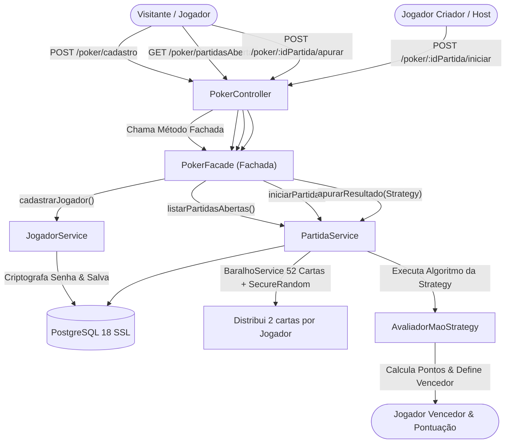

## 🌐🇧🇷 [Versão em Português do README](README.md)
## 🌐🇺🇸 [English Version of README](README_EN.md)

# ♠️ TexasHold-ES – API de Pôquer Texas Hold'em

API REST corporativa desenvolvida em **Java 21** e **Spring Boot** para gerenciamento de partidas de pôquer Texas Hold'em. O projeto incorpora padrões de projeto **GoF (Fachada / Facade e Strategy)**, Clean Code e SOLID, contemplando cadastro seguro de jogadores, lobby de mesas, controle de assentos, ciclo de rodadas, distribuição de cartas e contabilização de pontos para eleição do vencedor.

---

## 🔨 Funcionalidades do Projeto

- **US01 – Cadastro de Jogadores (`POST /poker/cadastro`):** Registro de visitantes com validação de dados, unicidade de e-mail e hash criptográfico via BCrypt.
- **US09 – Consulta de Partidas Abertas (`GET /poker/partidasAbertas`):** Listagem de mesas disponíveis com status `AGUARDANDO_JOGADORES`, contagem de jogadores e limite.
- **US10 – Entrada em Partida (`POST /poker/:idPartida/entrar`):** Validação de regras para entrada na mesa (capacidade máxima, partida aberta, duplicidade).
- **US12 – Início de Partida (`POST /poker/:idPartida/iniciar`):** Validação de autorização do criador e quórum mínimo de 2 jogadores.
- **US13 – Distribuição de Cartas:** Baralho de 52 cartas oficiais, embaralhamento via `SecureRandom` e distribuição automática de 2 cartas fechadas aos participantes.
- **Padrão Strategy – Contabilização e Apuração de Vencedor (`POST /poker/:idPartida/apurar`):** Avaliação dinâmica das mãos dos jogadores com determinação do vencedor e cálculo de pontos finais.
- **Padrão Fachada (Facade):** Ponto único e unificado de acesso à camada de domínio através da interface `PokerFacade`.

---

## 📸 Exemplo Visual da API

<div align="center">
  
  
  
</div>

---

## ✔️ Técnicas, Padrões e Tecnologias

- **Java 21 LTS** (Eclipse Temurin)
- **Spring Boot 4.1.x**
  - **Spring Web** (Controllers RESTful)
  - **Spring Data JPA** (Persistência relacional)
  - **Spring Security** (BCrypt Password Hashing)
  - **Spring Validation** (Bean Validation)
- **Padrões de Projeto (GoF):**
  - **Facade (Fachada):** `PokerFacade` encapsula e orquestra os subsistemas de Jogadores, Partidas, Baralho e Apuração.
  - **Strategy:** `AvaliadorMaoStrategy` (`RegraPokerStrategy`, `CartaAltaStrategy`, `ParesStrategy`, `AgrupamentosStrategy`, `SequenciaEFlushStrategy`) para cálculo de pontuações e avaliação de todas as mãos possíveis de Poker.
- **PostgreSQL 18** (Banco de dados de produção hospedado via Coolify com SSL)
- **H2 Database** (Banco em memória isolado para suíte de testes)
- **JUnit 5 & Mockito** (32 testes unitários e de integração)
- **Maven** (Gerenciamento de dependências e build)

---

## 📊 Fluxo da Aplicação



---

## 📁 Estrutura do Projeto

- **`src/main/java/com/projeto/texasholdes/`**
  - **`controller/`**: Endpoints HTTP REST da API (comunicação exclusiva com a Fachada).
  - **`facade/`**: Interface `PokerFacade` e implementação `PokerFacadeImpl`.
  - **`strategy/`**: Interface `AvaliadorMaoStrategy` e implementações de regras de avaliação.
  - **`service/`**: Regras de negócio, baralho e ciclo de partidas.
  - **`repository/`**: Interfaces de acesso ao banco com Spring Data JPA.
  - **`entity/`**: Entidades mapeadas (`Jogador`, `Partida`, `Carta`, `TipoCombinacao`).
  - **`dto/`**: Modelos de requisição e resposta desacoplados do banco de dados.
  - **`exception/`**: Handler global para respostas de erro padronizadas.
  - **`config/`**: Configurações de segurança e beans da aplicação.
- **`src/test/`**: Suíte de 32 testes automatizados cobrindo controllers, serviços, fachada e strategies.
- **`DATABASE.md`**: Guia completo de credenciais e conexão com o banco de dados.
- **`ARCHITECTURE.md`**: Detalhamento da arquitetura técnica do projeto.

---

## 🛠️ Abrir e rodar o projeto

### Pré-requisitos:
- **Java 21 (JDK)** instalado (`java -version`).

### 1. Executar os Testes Automatizados:
```bash
# Windows
.\mvnw test

# Linux / Mac
./mvnw test
```

### 2. Executar a Aplicação:
```bash
# Windows
.\mvnw spring-boot:run

# Linux / Mac
./mvnw spring-boot:run
```

A API estará disponível em: `http://localhost:8080`
