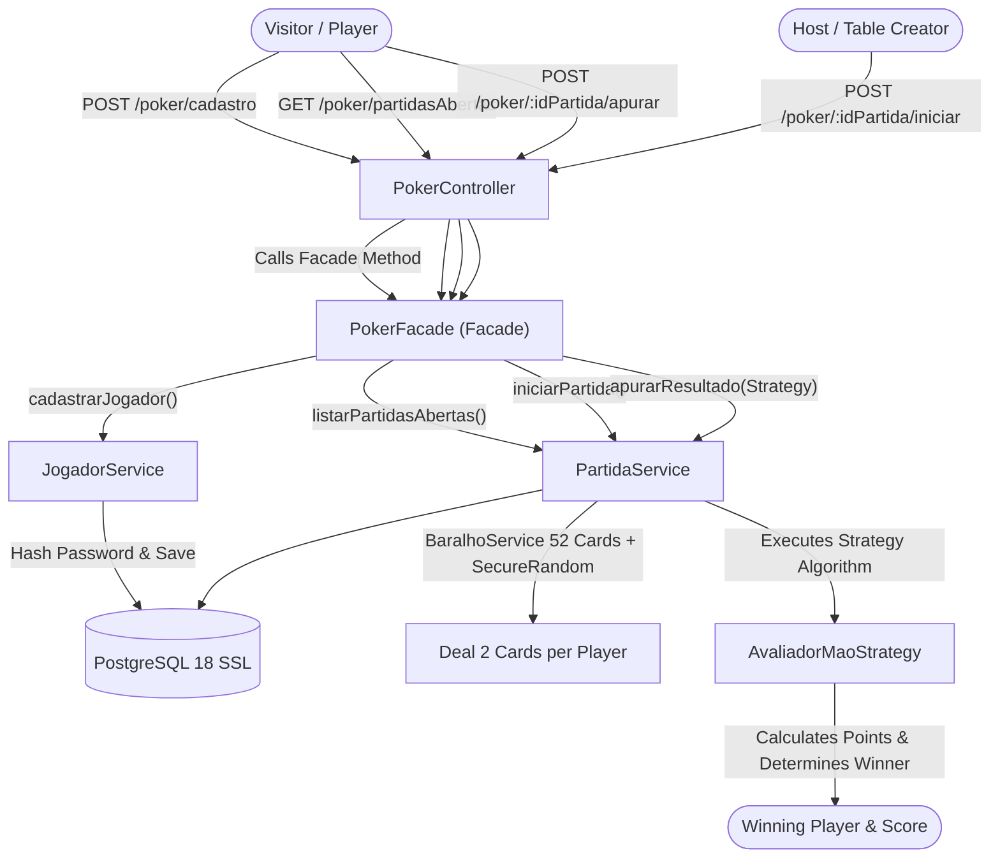

## 🌐🇧🇷 [Portuguese Version of README](README.md)
## 🌐🇺🇸 [English Version of README](README_EN.md)

# ♠️ TexasHold-ES – Texas Hold'em Poker API

RESTful API developed in **Java 21** and **Spring Boot** for managing Texas Hold'em poker matches, incorporating **GoF Design Patterns (Facade and Strategy)**, Clean Code, and SOLID principles.

---

## 🔨 Project Features

- **US01 – Player Registration (`POST /poker/cadastro`):** Visitor sign-up with bean validation, unique email constraint, and BCrypt password hashing.
- **US09 – Open Tables Discovery (`GET /poker/partidasAbertas`):** Retrieve available tables open for seating, displaying current player count and maximum capacity.
- **US10 – Joining a Match (`POST /poker/:idPartida/entrar`):** Validations for joining a table (capacity limits, table open status, duplicate player prevention).
- **US12 – Starting a Match (`POST /poker/:idPartida/iniciar`):** Validation of creator/host authorization and minimum requirement of at least 2 seated players.
- **US13 – Card Distribution:** Generation of an official 52-card deck, cryptographic card shuffling with `SecureRandom`, and automatic dealing of 2 private hole cards per player upon match start.
- **Strategy Pattern – Round Scoring & Winner Determination (`POST /poker/:idPartida/apurar`):** Dynamic hand evaluation and winner election across all possible poker combinations.
- **Facade Pattern:** Unified access interface to the domain subsystem via `PokerFacade`.

---

## 📸 Visual Overview

<div align="center">
  
  
  
</div>

---

## ✔️ Techniques, Patterns and Technologies

- **Java 21 LTS** (Eclipse Temurin)
- **Spring Boot 4.1.x**
  - **Spring Web** (RESTful Controllers)
  - **Spring Data JPA** (Relational ORM & Repositories)
  - **Spring Security** (BCrypt Password Encoder)
  - **Spring Validation** (Bean Validation)
- **GoF Design Patterns:**
  - **Facade:** `PokerFacade` encapsulates players, matches, decks, and evaluation subsystems.
  - **Strategy:** `AvaliadorMaoStrategy` (`RegraPokerStrategy`, `CartaAltaStrategy`, `ParesStrategy`, `AgrupamentosStrategy`, `SequenciaEFlushStrategy`) for scoring every poker hand scenario.
- **PostgreSQL 18** (Production database hosted via Coolify with SSL)
- **H2 Database** (Isolated in-memory database for testing)
- **JUnit 5 & Mockito** (32 unit and integration tests)
- **Maven** (Dependency and build management)

---

## 📊 Application Flow Diagram



---

## 📁 Project Structure

- **`src/main/java/com/projeto/texasholdes/`**
  - **`controller/`**: RESTful API endpoints (interacting solely with `PokerFacade`).
  - **`facade/`**: `PokerFacade` interface and `PokerFacadeImpl` implementation.
  - **`strategy/`**: `AvaliadorMaoStrategy` interface and evaluation algorithms.
  - **`service/`**: Domain services, card deck management, match orchestration.
  - **`repository/`**: Spring Data JPA repository layer.
  - **`entity/`**: Database entities (`Jogador`, `Partida`, `Carta`, `TipoCombinacao`).
  - **`dto/`**: Request and response transfer models decoupled from persistence.
  - **`exception/`**: Global exception handler returning standardized error JSONs.
  - **`config/`**: Security configuration and application beans.
- **`src/test/`**: Automated suite containing 32 tests using H2.
- **`DATABASE.md`**: Infrastructure guide and connection strings.
- **`ARCHITECTURE.md`**: Technical architecture specification.

---

## 🛠️ How to Run the Project

### Prerequisites:
- **Java 21 (JDK)** installed (`java -version`).

### 1. Run the Automated Tests:
```bash
# Windows
.\mvnw test

# Linux / Mac
./mvnw test
```

### 2. Start the Application:
```bash
# Windows
.\mvnw spring-boot:run

# Linux / Mac
./mvnw spring-boot:run
```

The API will be available at: `http://localhost:8080`
